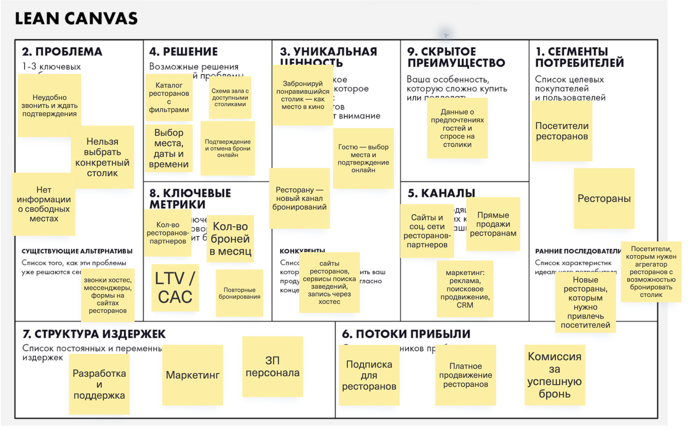

# Проект «Онлайн-бронирование столиков в ресторанах»

## Задание №1

**Бизнес-модель:** B2B2C. Рестораны оплачивают сервис, гости бронируют бесплатно.

### Elevator Pitch

Чтобы забронировать столик, приходится звонить в ресторан и ждать подтверждения, а конкретное место обычно выбирает хостес. Приложение позволяет найти ресторан, посмотреть схему зала и забронировать понравившийся столик — как место в кино. Гости экономят время и заранее знают, где будут сидеть, а рестораны получают новый канал бронирований. Доходы платформы: подписка ресторанов, комиссия за успешную бронь, платное продвижение. 

### Lean Canvas

#### 1. Сегменты потребителей

- Посетители ресторанов: встречи с друзьями, семейные и деловые посещения.
- Рестораны, бары и кафе с предварительным бронированием.
- **Ранние последователи:** новые рестораны, которым нужны гости, и посетители, которым важен выбор конкретного столика.

#### 2. Проблемы

- Неудобно звонить и ждать подтверждения.
- Нельзя заранее выбрать конкретный столик.
- Нет актуальной информации о свободных местах.
- **Альтернативы:** звонок хостес, мессенджеры, формы записи на сайтах ресторанов.

#### 3. Уникальная ценность

- «Забронируй понравившийся столик — как место в кино».
- Гостю — выбор места и подтверждение онлайн.
- Ресторану — новый канал бронирований.

#### 4. Решение

- Каталог ресторанов с фильтрами.
- Схема зала с доступными столиками.
- Выбор места, даты и времени.
- Подтверждение и отмена брони онлайн.

#### 5. Каналы

- Сайты и соцсети ресторанов-партнёров.
- Реклама, поисковое продвижение и CRM-рассылки.
- Прямые продажи ресторанам.

#### 6. Потоки доходов

- Подписка для ресторанов.
- Комиссия за успешную бронь.
- Платное продвижение ресторанов.
- Платный доступ к API для партнёров.

#### 7. Структура издержек

- Разработка, интеграции и поддержка.
- Серверы и уведомления.
- Маркетинг и зарплаты персонала.

#### 8. Ключевые метрики

- Количество ресторанов-партнёров.
- Количество броней в месяц.
- Повторные бронирования.
- LTV / CAC.

#### 9. Скрытое преимущество

- Накопленные данные о предпочтениях гостей и спросе на столики.
- Партнёрская сеть и отлаженные интеграции с ресторанами.
- Преимущество формируется по мере развития платформы.

## Задание №2

### 1. HADI-гипотеза

**Критичный риск:** рестораны не готовы платить за платформу.

- **H:** минимум 4 из 20 ресторанов после пилота оплатят подписку за 5 000 ₽ в месяц.
- **A:** за шесть недель проведу 20 демонстраций, предложу 14-дневный пилот и последующую оплату. Цена известна заранее.
- **D:** число оплат, конверсия из демонстрации в оплату, причины отказов.
- **I:** 4 и более оплат — предварительное подтверждение; 2–3 — повторная проверка; 0–1 — пересмотр предложения.

### 2. Юнит-экономика

**Юнит — платящий ресторан.** Считаю только подписку; комиссии, продвижение и API — дополнительные источники дохода.

**Воронка и CAC:**

- 1 000 целевых переходов по 100 ₽ → 100 000 ₽ на рекламу.
- Конверсия в заявку — 10% → 100 заявок.
- Конверсия в демонстрацию — 50% → 50 демонстраций.
- Конверсия в оплату — 20% → 10 платящих ресторанов.
- Продажи и инструменты — 50 000 ₽, первичное подключение — 30 000 ₽.
- **CAC = (100 000 + 50 000 + 30 000) / 10 = 18 000 ₽.**

**LTV:**

- Подписка — 5 000 ₽ в месяц.
- Переменные расходы — 1 500 ₽ в месяц: инфраструктура, уведомления, сопровождение и привлечение гостей.
- Маржинальный доход — 5 000 − 1 500 = 3 500 ₽ в месяц.
- Средний срок использования — 18 месяцев.
- **LTV = 3 500 × 18 = 63 000 ₽.**

**LTV / CAC = 3,5.** Выполняется условие LTV > 3 × CAC. Привлечение окупается за 18 000 / 3 500 ≈ **5,1 месяца**. Постоянные расходы команды и разработка в расчёт не включены.

### 3. Pivot

**Резервный план — переход от B2B2C-агрегатора к B2B-виджету для сайтов ресторанов.**

Если привлечение гостей окажется слишком дорогим, ресторан сможет установить выбор столика на собственный сайт. Переиспользуются схема зала, бронирование и интеграции. Доход — подписка ресторана. Гостей он привлекает через свои каналы.

**Elevator Pitch:** виджет позволяет гостям выбрать и забронировать столик прямо на сайте ресторана. Ресторан получает готовые брони в своей системе, сокращает обработку звонков и сохраняет собственный бренд.

## Задание №3

### 1. Роли, User Stories и приоритизация MoSCoW

**Роли:**

- Неавторизованный пользователь — регистрация, просмотр каталога и поиск ресторанов.
- Авторизованный пользователь — бронирование, просмотр и отмена своих броней.
- Администратор ресторана — подключение заведения, управление профилем, схемой зала и просмотр бронирований.
- Администратор платформы — проверка заявок и активация ресторанов.

Сегменты посетителей: встречи с друзьями, семейные посещения и деловые встречи.

| ID | User Story | MoSCoW |
| --- | --- | --- |
| US-01 | Как неавторизованный пользователь, я хочу зарегистрироваться и войти, чтобы бронировать столики. | Must |
| US-02 | Как пользователь, я хочу искать рестораны по расположению, кухне и среднему чеку, чтобы найти подходящее заведение. | Must |
| US-03 | Как пользователь, я хочу видеть описание и фотографии ресторана, чтобы оценить его перед посещением. | Must |
| US-04 | Как пользователь, я хочу выбрать свободный столик на схеме зала, чтобы заранее знать, где буду сидеть. | Must |
| US-05 | Как авторизованный пользователь, я хочу забронировать столик и получить подтверждение, чтобы спланировать посещение. | Must |
| US-06 | Как авторизованный пользователь, я хочу видеть предстоящие и прошлые брони, чтобы управлять посещениями. | Must |
| US-07 | Как авторизованный пользователь, я хочу отменить бронь, чтобы освободить столик при изменении планов. | Must |
| US-08 | Как администратор ресторана, я хочу видеть брони с датой, временем и данными гостей, чтобы подготовиться к их приходу. | Must |
| US-09 | Как администратор ресторана, я хочу подать заявку на подключение, чтобы принимать бронирования через платформу. | Should |
| US-10 | Как администратор платформы, я хочу проверять и одобрять заявки ресторанов, чтобы публиковать проверенные заведения. | Should |
| US-11 | Как администратор ресторана, я хочу редактировать профиль заведения, чтобы поддерживать актуальность информации. | Should |
| US-12 | Как администратор ресторана, я хочу редактировать схему зала и параметры столиков, чтобы гости выбирали подходящие места. | Should |
| US-13 | Как пользователь с детьми, я хочу находить рестораны с детским меню и игровой комнатой, чтобы выбрать место для семьи. | Should |
| US-14 | Как авторизованный пользователь, я хочу встать в лист ожидания, чтобы узнать об освободившемся столике. | Should |
| US-15 | Как авторизованный пользователь, я хочу получать персональные рекомендации ресторанов, чтобы быстрее выбирать заведения. | Won't |

### 2. MVP и MLP

**MVP — US-01–US-08:** поиск, карточка ресторана, выбор конкретного столика, бронирование, подтверждение, просмотр и отмена броней. Интеграция передаёт брони в систему ресторана и учитывает занятость из неё. Первые рестораны подключаются вручную; профили, схемы залов и учётные записи администраторов готовятся до запуска.

**MLP — MVP + US-09–US-14:** самостоятельная подача заявок, модерация, редактирование профиля и схемы, семейные фильтры и лист ожидания. Персональные рекомендации — вне текущего релиза.

### 3. Требования к двум главным историям MVP

Численные показатели ниже — целевые требования, а не результаты замеров работающего сервиса.

#### US-02. Поиск ресторанов

**Функциональные требования:**

- **FR-02.1.** Поиск доступен без авторизации. Пользователь задаёт район, тип кухни и диапазон среднего чека.
- **FR-02.2.** Система применяет все выбранные фильтры одновременно и показывает только соответствующие им рестораны.
- **FR-02.3.** Карточка результата содержит название, адрес, тип кухни, средний чек и фотографию. 
- **FR-02.4.** При отсутствии результатов система показывает сообщение «Ничего не найдено» и предлагает изменить или сбросить фильтры.
- **FR-02.5.** Отрицательные значения чека и диапазон с нижней границей выше верхней отклоняются с пояснением ошибки.

**Нефункциональные требования:**

- **NFR-02.1. Производительность.** При нагрузке 50 поисковых запросов в секунду не менее 95% поисков завершаются отображением результатов за 2 секунды. 
- **NFR-02.2. Совместимость.** Поиск и фильтрация должны работать в последних стабильных версиях Chrome, Firefox и Safari. 

#### US-05. Онлайн-бронирование столика

**Функциональные требования:**

- **FR-05.1.** Перед отправкой пользователь подтверждает ресторан, столик, дату, начало и окончание посещения, число гостей и контакты. Прошедшее время, некорректный интервал и превышение вместимости отклоняются.
- **FR-05.2.** Система проверяет отсутствие другой активной брони пользователя в этом ресторане на пересекающееся время и отправляет запрос в API ресторана.
- **FR-05.3.** Система ресторана проверяет доступность и резервирует столик одной неделимой операцией. Если столик занят, приложение предлагает выбрать другое время или место.
- **FR-05.4.** Только после подтверждения рестораном и сохранения результата приложение показывает уникальный номер брони в разделе «Мои бронирования» и инициирует email-подтверждение. 

**Нефункциональные требования:**

- **NFR-05.1. Производительность.** При ответе API ресторана не более чем за 500 мс не менее 95% одиночных операций бронирования завершаются отображением подтверждения за 1,5 секунды. 
- **NFR-05.2. Надёжность.** Из 100 одновременных попыток забронировать один свободный столик на одинаковый интервал успешно завершается ровно одна. Повторы запроса с тем же идентификатором возвращают результат исходной операции.
- **NFR-05.3. Безопасность.** Передача данных — только по HTTPS; хранилища и резервные копии с контактами гостей зашифрованы. Просмотр брони разрешён её владельцу и администратору соответствующего ресторана.

**Общее требование для приложения:**

- Доступность приложения — не менее 99,95% за календарный месяц: не более 21,6 минуты недоступности за 30 дней. Доступность внешнего API ресторана учитывается отдельно.

